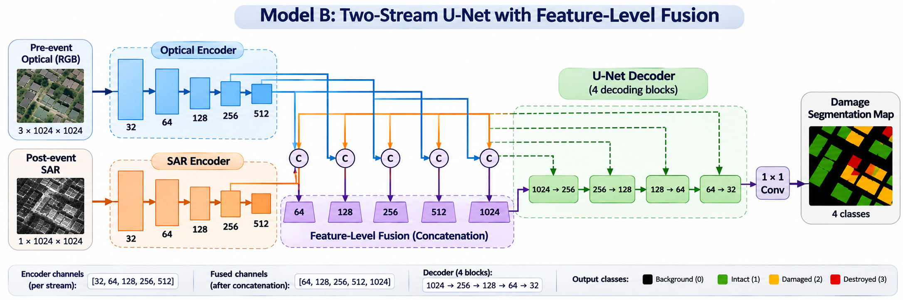

# BRIGHT – Model B: Two-Stream Feature-Level Fusion for Building Damage Assessment

## Overview

This project implements a multimodal semantic segmentation model for building damage assessment using the **BRIGHT dataset**.

The model combines pre-event optical imagery and post-event Synthetic Aperture Radar (SAR) imagery through a two-stream encoder architecture with feature-level fusion.

The objective is to classify each pixel into one of four building damage categories.

### Dataset and Reference

This project uses the **BRIGHT dataset** for multimodal building damage assessment, combining pre-event optical imagery and post-event Synthetic Aperture Radar (SAR) imagery.

If you use this dataset or build upon this work, please cite the original BRIGHT paper:

Chen, H., Song, J., Dietrich, O., Broni-Bediako, C., Xuan, W., Wang, J., Shao, X., Wei, Y., Xia, J., Lan, C., Schindler, K., and Yokoya, N. (2025). *BRIGHT: A globally distributed multimodal building damage assessment dataset with very-high-resolution for all-weather disaster response*. Earth System Science Data, 17, 6217–6253.

https://doi.org/10.5194/essd-17-6217-2025

**Dataset:** https://doi.org/10.5281/zenodo.14619797

## Experimental Environment

The original implementation, training, and evaluation of Model B were carried out in **Google Colab**, using GPU acceleration.

The notebook `BRIGHT_2encodersUNET.ipynb` contains the original experimental workflow, including data preparation, model implementation, training, validation, and test evaluation.

The modular Python files are provided to organize the implementation into separate components and facilitate code navigation, understanding, and reuse.

### Model Architecture

Model B uses a two-stream U-Net-based architecture:

- **Optical Encoder:** Processes pre-event RGB images (3 input channels).
- **SAR Encoder:** Processes post-event SAR images (1 input channel).
- **Feature-Level Fusion:** Features extracted by both encoders are concatenated at each encoder resolution.
- **Decoder:** A U-Net-style decoder progressively reconstructs the segmentation map.
- **Classifier:** A final 1 × 1 convolution predicts four semantic classes.

### Architecture Details



Encoder channels:

`[32, 64, 128, 256, 512]`

After feature concatenation:

`[64, 128, 256, 512, 1024]`

Output classes:

| Label | Class |
|---|---|
| 0 | Background |
| 1 | Intact |
| 2 | Damaged |
| 3 | Destroyed |
| 255 | Ignore index |

## Dataset

The experiments use the BRIGHT multimodal building damage dataset.

- 4,246 paired optical and SAR image samples.
- Image resolution: 1024 × 1024 pixels.
- Optical imagery: pre-event.
- SAR imagery: post-event.

Official standard_ML split:

| Split | Number of images |
|---|---:|
| Training | 2,918 |
| Validation | 450 |
| Test | 878 |
| **Total** | **4,246** |

The dataset and split files are not included in this repository.

## Training Configuration

| Parameter | Value |
|---|---|
| Input crop size | 512 × 512 |
| Batch size | 16 |
| Epochs | 50 |
| Optimizer | AdamW |
| Learning rate | 0.0001 |
| Weight decay | 0.005 |
| Loss function | Cross Entropy + Lovasz-Softmax |
| Lovasz weight | 0.75 |
| Best validation epoch | 44 |

### Data Augmentation

Synchronized augmentations are applied to optical images, SAR images, and segmentation masks:

- Random cropping
- Horizontal flipping
- Vertical flipping
- Random rotations of 90°, 180°, and 270°

Normalization statistics are calculated using the training dataset.

## Experimental Results

The best checkpoint was selected based on validation mIoU.

### Test Set Performance

| Metric | Result |
|---|---:|
| Test Loss | 0.3697 |
| Overall Accuracy (OA) | 94.36% |
| Mean IoU (mIoU) | 58.45% |

### Per-Class Performance

| Class | IoU | F1-score |
|---|---:|---:|
| Background | 95.11% | 97.49% |
| Intact | 66.27% | 79.71% |
| Damaged | 25.80% | 41.02% |
| Destroyed | 46.63% | 63.60% |

The results show stronger segmentation performance for Background and Intact classes, while Damaged remains the most challenging category.

## Repository Structure

```text
BRIGHT-Model-B/
├── configs/
│   └── config.py
├── datasets/
│   └── bright_dataset.py
├── losses/
│   └── combined_loss.py
├── models/
│   ├── encoder.py
│   ├── decoder.py
│   └── two_stream_fusion.py
├── notebooks/
│   └── BRIGHT_2encodersUNET.ipynb
├── results/
│   ├── graphs/
│   ├── metrics/
│   ├── predictions/
│   ├── confusion_matrix.png
│   └── confusion_matrix_normalized.png
├── scripts/
│   ├── train.py
│   ├── evaluate.py
│   └── predict.py
├── utils/
│   ├── inference.py
│   └── metrics.py
├── README.md
├── requirements.txt
└── .gitignore
```

## Installation

Clone the repository:

```bash
git clone YOUR_REPOSITORY_URL
cd BRIGHT-Model-B
```

Install dependencies:

```bash
pip install -r requirements.txt
```

Configure dataset paths and experiment parameters in:

`configs/config.py`

The BRIGHT dataset and official split files must be downloaded separately and placed in the configured locations.

## Running the Experiments

Training:

```bash
python -m scripts.train
```

Evaluation:

```bash
python -m scripts.evaluate
```

Prediction:

```bash
python -m scripts.predict
```

These scripts require the dataset, split files, and trained checkpoint to be available at the configured paths.

## Results and Visualizations

The `results/` directory contains:

- Training and validation loss curves.
- Validation mIoU and OA curves.
- Per-class test IoU and F1-score plots.
- Confusion matrices.
- Test metrics in CSV and JSON formats.
- Qualitative segmentation predictions.

## Checkpoints and Data Availability

The trained model checkpoints (`best_model.pth` and `last_model.pth`) and the original BRIGHT dataset are stored separately and are not included in this repository due to their size.

## Acknowledgements

This project was developed as part of a university research project on multimodal semantic segmentation for post-disaster building damage assessment using optical and SAR imagery.
